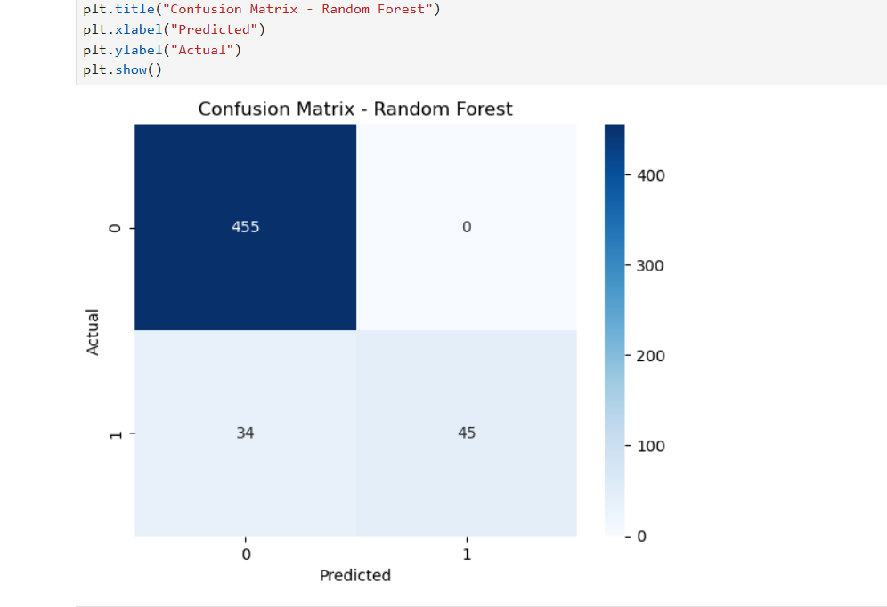
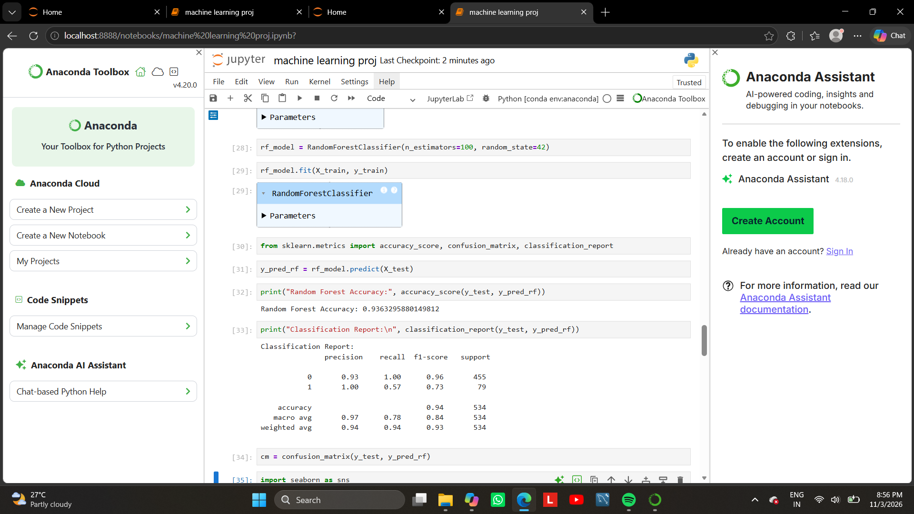

# Telecom Churn Prediction (Machine Learning)

## 📌 Overview

This project uses Machine Learning to predict customer churn in a telecom company. The objective is to identify customers who are likely to discontinue services and help businesses improve customer retention.

## 🛠 Tools Used

- Python
- Pandas
- NumPy
- Scikit-learn
- Matplotlib
- Seaborn
- Jupyter Notebook

## 🔄 Workflow

1. Data Collection
2. Data Cleaning
3. Exploratory Data Analysis
4. Feature Engineering
5. Model Training
6. Model Evaluation

## 📊 Key Insights

- Customers with month-to-month contracts showed higher churn rates.
- Contract type and tenure significantly influenced churn.
- High monthly charges increased the likelihood of churn.

## 📷 Model Results

### Confusion Matrix

### Accuracy Score

## 📈 Machine Learning Techniques

- Logistic Regression
- Random Forest
- Classification
- Feature Engineering
- Model Evaluation

## 🎯 Business Value

This project demonstrates how predictive analytics can be used to identify customers at risk of leaving, enabling businesses to take proactive retention measures.

---

⭐ Machine Learning Project using Python & Scikit-learn
